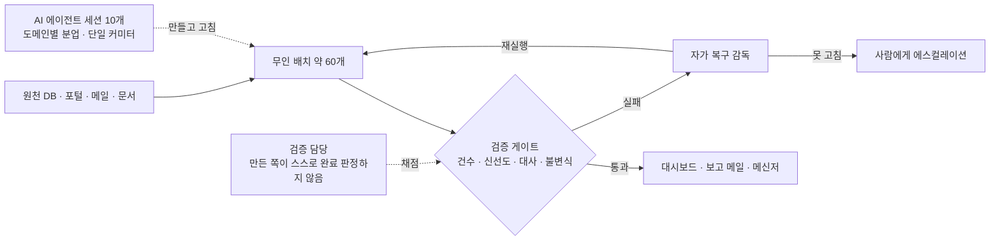

# Ethan · Finance × AI (AX)

**재무 현업 문제를 직접 AI 시스템으로 만들고, 매일 운영하며, 검증 게이트로 결과를 책임집니다.**
 Finance professional (8 yrs) who builds, runs and verifies AI systems for real finance operations — measured, not claimed.

외식 프랜차이즈 본사 재무 8년차 · 사내 Finance팀 공식 AI 챔피언 · 📫 **cloudavenue0012@gmail.com** — 재무 × AI 실무 이야기·협업 환영합니다

| 무인 배치 | 거짓 «효과 있음» 판정 | «성공처럼 보이는 실패» 탐지 |
|:---:|:---:|:---:|
| **약 60개** 매일 운영 | **56.3% → 0.4%** | **exit 코드 0% → 산출물 검증 100%** |
| 에이전트 세션 10개 분업 | [Decision Impact Eval](https://github.com/cloudavenue0012-creator/decision-impact-eval) | [Self-Healing Automation](https://github.com/cloudavenue0012-creator/self-healing-automation) |

> **원칙 —** AI 산출물도 검증 없이는 쓰지 않습니다. 신뢰는 "틀리지 않는다"가 아니라 <b>"틀리면 걸러진다"</b>에서 나옵니다.

---

### 어떻게 돌아가나

---

### 무엇을 해내나

| 역량 | 근거 |
|---|---|
| **재무 프로세스를 무인 운영 시스템으로 전환** — 데이터 적재부터 대시보드·보고 발송까지 사람 손 없이 | 무인 배치 **약 60개** 매일 운영 · exit 코드가 아니라 **산출물로 성공 판정** |
| **AI 에이전트를 팀처럼 운영** — 도메인별 역할 분담, 공유 자원 충돌 방지 | 에이전트 세션 **10개** 동시 운영 · 단일 커미터 규약 · 진행·막힘 상황판 |
| **실수를 그날 바로 절차로 고정** — 같은 실수를 사람 기억에 맡기지 않음 | 재사용 업무 절차(스킬) **130여 개** |
| **주장 대신 측정** — 모든 산출물을 eval·CI로 검증 | 아래 7개 repo 전부 eval + CI 게이트 |

**적용 영역** 손익 마감 · 매출 재현/대사 · 정산 RPA · 자금 · 원가/투자 검증 · 문서 추출 · 회의 → 액션 성과 판정

---

### 대표 프로젝트 — 실무 설계를 합성 데이터로 재구현 (회사 데이터 없음)

| 프로젝트 | 푸는 문제 | 측정 결과 |
|---|---|---|
| [Operating-Income Bridge](https://github.com/cloudavenue0012-creator/operating-income-bridge) | 영업이익 증감을 물량·믹스·가격·원가·환율·판관비로 분해 | `OP0 + 6요인 = OP1` 잔차 0 · 심은 드라이버 복원율 1.0 |
| [Forecast Tournament](https://github.com/cloudavenue0012-creator/forecast-tournament) | 추정 엔진 8개를 매달 확정 실적으로 채점해 다음 달 엔진을 고르는 경주 | 시험 칸 94.5%에서 3개월 평균보다 정확 · 미마감 수치 고착 시 실제 오차 50.4%가 스스로는 7.4%로 보이는 함정을 게이트가 차단 |
| [Decision Impact Eval](https://github.com/cloudavenue0012-creator/decision-impact-eval) | 회의에서 정한 조치가 실제로 효과를 냈는지 매장 단위 인과 판정(순열검정·요일·시간 교락·플라시보 게이트) | 효과 없는 결정의 거짓 효과 주장률 단순 전후 56.3% → 0.4% · 실제 효과 포착 70% · 런칭 곡선 착시(+156%, p=0.0001)를 시간 교락 게이트만 차단 |
| [Settlement Reconciliation Engine](https://github.com/cloudavenue0012-creator/settlement-reconciliation-engine) | 다채널 정산을 독립 재계산해 대조 · 규칙 변경 전후 대조 · 장부/재계산/정산 3-way 대사 | 이상탐지 F1 0.956 · recall 100% · 규칙 변경 결함 90.5% 탐지(오경보 0, 월 합계 점검은 54.8%) · 오류 위치 판별 97.2%(2-way 25.8%) |
| [Verification-Gated Agents](https://github.com/cloudavenue0012-creator/verification-gated-agents) | 검증 게이트가 에이전트 신뢰도에 주는 효과 | 0.55 → 0.97+ · 노이즈 게이트는 최적점 이후 오히려 하락(과잉 게이팅) |
| [Self-Healing Automation](https://github.com/cloudavenue0012-creator/self-healing-automation) | 무인 자동화의 감지 → 복구 → 결과 검증, exit 0 으로 끝나는 «성공처럼 보이는 실패» 7유형(실제 사고 일반화) | 결과 검증을 끄면 7%가 거짓 «복구됨» · 7유형 탐지율 exit 코드만 0% / 파일 존재 1.5% / 산출물 검증 100%(오경보 0.65%) |
| [Utility-Bill Extraction Eval](https://github.com/cloudavenue0012-creator/utility-bill-extraction-eval) | 문서 추출 → 금액 대사 2층 eval | 추출 품질이 대사 F1의 상한임을 sweep으로 확인 · denoise 가설은 McNemar 검정으로 기각 |

---

### 틀렸던 기록 — 스스로 찾아 고친 것
- **내 벤치마크가 리깅돼 있었다.** 정산 엔진 첫 공개판은 합성 잡음이 평가 기준(허용오차)을 따라 움직여, 튜닝 곡선이 아무것도 재지 못하고 있었습니다. 직접 찾아 고치고, 그 판별 과정을 [한 줄로 재현되는 스크립트](https://github.com/cloudavenue0012-creator/settlement-reconciliation-engine)로 남겼습니다.
- **+1645%, p=0.0001 이 효과가 아니었다.** 할인 효과로 보이던 수치가 채널 런칭 곡선이었고, 순열검정·요일 균형 두 게이트는 그걸 통과시켰습니다 → 시간 교락 게이트를 새로 세웠습니다([Decision Impact Eval](https://github.com/cloudavenue0012-creator/decision-impact-eval)).
- **내가 세운 통과 기준이 데이터에서 성립하지 않았다.** 「사후에 고른 최고 엔진보다 항상 낫다」를 포기하고 후회 상한으로 바꾼 이유를 README에 그대로 적었습니다([Forecast Tournament](https://github.com/cloudavenue0012-creator/forecast-tournament)).

---

### Stack
`Python` · `SQL (PostgreSQL)` · `pandas` · `Playwright` · `Excel 자동화 (win32com/openpyxl)` · `Streamlit` · `Cloudflare Pages/Workers/D1` · `GitHub Actions`
`Claude Code` 멀티 세션 오케스트레이션 · `MCP` · 로컬 LLM·VLM(`Ollama`) · eval·검증 게이트 설계 · 무인 배치 자가 복구
